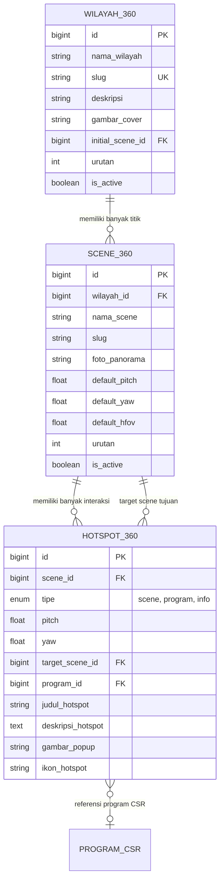

# Konsep & Arsitektur Pengembangan Virtual Tour 360
## Portal Keberlanjutan & Pemetaan CSR PT Pertamina Patra Niaga x PCR

Dokumen ini menjelaskan rancangan arsitektur, struktur folder penyimpanan foto, skema database relasional MySQL, alur interaksi dashboard admin (WYSIWYG), serta integrasi pop-up program CSR interaktif untuk fitur **Virtual Tour 360**.

---

## 1. Konsep & Hirarki Entitas

Sistem Virtual Tour 360 dirancang dengan hirarki 3 level:

```
[Level 1: Wilayah / Daerah] (contoh: Mundam Jaya, Bukit Timah)
   │
   └─── [Level 2: Scene / Titik Panorama] (contoh: Gerbang Utama, Kebun Sayur, Saung Edukasi)
           │
           └─── [Level 3: Hotspots / Titik Interaktif]
                   ├── a. Hotspot Navigasi (Panah pindah ke Scene lain)
                   └── b. Hotspot Program / Info (Pop-up kartu program CSR)
```

1. **Wilayah (Area/Lokasi)**: Entitas induk yang mewakili satu kawasan binaan CSR (misal: *Kelurahan Mundam Jaya*). Setiap wilayah memiliki satu *Initial Scene* (titik pertama yang terbuka ketika pengunjung masuk).
2. **Scene (Panorama Equirectangular 360)**: Satu titik foto 360 derajat. Pengunjung dapat memutar kamera ke segala arah (360° horizontal, 180° vertikal).
3. **Hotspot**: Ikon interaktif yang menempel pada koordinat sudut panorama:
   * **Hotspot Navigasi (`scene`)**: Berfungsi seperti pintu/panah jalan untuk berpindah ke titik scene berikutnya.
   * **Hotspot Program (`program`)**: Terhubung langsung ke tabel `program_csr`. Saat diklik, memunculkan modal pop-up dengan ringkasan program, foto cover, dan tombol navigasi langsung ke halaman detail program.
   * **Hotspot Info Bebas (`info`)**: Pop-up teks informasi umum, edukasi lingkungan, atau foto dokumentasi.

---

## 2. Struktur Penyimpanan File & Folder Foto (Hostinger / Shared Hosting Ready)

Sistem mengadopsi penyimpanan berbasis path publik langsung di `public/uploads/` agar **100% kompatibel dengan Shared Hosting (Hostinger cPanel/hPanel)** tanpa ketergantungan pada `php artisan storage:link` (symlink).

Admin tidak perlu membuat folder secara manual di file manager. Saat admin membuat wilayah dan mengunggah foto, backend Laravel akan membuatkan subfolder secara otomatis berdasarkan `slug` wilayah:

```text
backend/public/uploads/
└── tour360/
    ├── mundam-jaya/
    │   ├── cover/
    │   │   └── cover_mundam_jaya.webp       (Cover kartu wilayah di beranda)
    │   ├── panoramas/
    │   │   ├── scene_gerbang_depan.jpg      (Foto 360 Equirectangular resolusi tinggi)
    │   │   ├── scene_kebun_sayur.jpg        (Foto 360 Titik 2)
    │   │   └── scene_saung_workshop.jpg     (Foto 360 Titik 3)
    │   └── hotspots/
    │       └── popup_foto_kegiatan.webp     (Foto pelengkap pop-up info jika ada)
    │
    └── bukit-timah/
        ├── cover/
        └── panoramas/
```

> **Spesifikasi Rekomendasi Foto 360:**
> * Rasio aspek: **2:1** (Equirectangular).
> * Resolusi ideal: **4096 x 2048** piksel (atau maks 6000 x 3000) berformat `.jpg` berkualitas 85% untuk keseimbangan ketajaman visual dan kecepatan loading di web.

---

## 3. Skema Database Relasional (MySQL)

Tiga tabel baru saling terhubung dan berelasi dengan tabel `program_csr` yang sudah aktif:



### Penjelasan Kolom Kunci:
1. **`wilayah_360.initial_scene_id`**: Menentukan foto 360 pertama yang ditampilkan saat pengunjung membuka halaman virtual tour wilayah terkait.
2. **`scene_360.default_pitch` & `default_yaw`**: Sudut pandang kamera pertama kali menghadap ke arah mana (misal menghadap ke pintu gerbang).
3. **`hotspot_360.pitch` & `hotspot_360.yaw`**: Koordinat derajat letak ikon di dalam ruang bola 360.
4. **`hotspot_360.program_id`**: Foreign Key opsional yang menghubungkan hotspot ke tabel `program_csr`, menjamin data program di pop-up selalu sinkron dengan data CMS.

---

## 4. Rancangan Tampilan & UX Dashboard Admin (Anti-Ribet)

Untuk menghindari kerepotan mengetik derajat koordinat secara manual, dashboard admin menggunakan alur kerja bertingkat (3 Level) dengan dukungan editor visual **WYSIWYG**:

### Level 1: Daftar Wilayah Tour (`/admin/tour-360`)
* Berisi daftar kartu/tabel wilayah CSR Pertamina.
* Kolom: Cover, Nama Wilayah, Total Titik Scene, Status Publikasi, dan tombol aksi.
* Tombol utama: **"Kelola Titik Panorama"** untuk masuk ke Level 2.

### Level 2: Manajer Scene / Titik Jalan
* Menampilkan daftar semua titik foto panorama di wilayah yang dipilih dalam bentuk grid kartu.
* Tombol **"Tambah Titik 360 Baru"**:
  * Input: Nama Titik (misal: *"Area Persemaian Bibit"*).
  * Upload file foto 360 dari komputer lokal (langsung masuk ke `public/uploads/tour360/{wilayah}/panoramas/`).
  * Checkbox: *"Jadikan Titik Utama (Pintu Masuk)"*.
* Di setiap kartu scene, terdapat tombol: **"Edit Hotspot Visual"** untuk masuk ke Level 3.

### Level 3: Visual Hotspot Editor (WYSIWYG 360)
* Menampilkan layar preview 360 interaktif secara penuh di dalam dashboard.
* **Alur Penambahan Hotspot oleh Admin:**
  1. Admin menggeser mouse/kamera 360 ke arah jalan setapak atau objek binaan CSR.
  2. **Klik langsung pada objek/titik tersebut di layar viewer**.
  3. Sistem secara otomatis membaca koordinat derajat `pitch` dan `yaw` dari posisi klik mouse.
  4. Muncul dialog modal sederhana:
     * **Pilihan A (Pindah Titik Jalan)**:
       * Pilih target scene dari dropdown (misal: *"Menuju Kebun Sayur"*).
     * **Pilihan B (Pop-up Program CSR)**:
       * Pilih program CSR dari dropdown yang terhubung ke database (misal: *"Program Halimah"*).
       * Preview kartu langsung terlihat otomatis.
     * **Pilihan C (Info Edukasi / Dokumentasi)**:
       * Masukkan judul, deskripsi singkat, dan upload foto pendukung.
  5. Klik tombol **"Simpan Hotspot"**. Ikon langsung muncul di layar dan dapat diuji coba seketika oleh admin.

---

## 5. Tampilan & Interaksi di Sisi Pengunjung (Publik)

1. **Akses dari Halaman Beranda**:
   * Pengunjung mengklik salah satu kartu wilayah pemetaan di section Virtual Tour.
   * Layar membuka sub-halaman `/tour-360/:slug` dengan mode interaktif layar penuh atau jendela terkontrol.
2. **Navigasi Jalan 360**:
   * Ikon panah beranimasi halus (pulsing) menandakan titik akses jalan ke lokasi berikutnya.
   * Transisi antar scene dilengkapi efek *fade-in/fade-out* halus untuk memberikan kesan berjalan di lokasi nyata.
3. **Pop-up Interaktif Program CSR**:
   * Saat pengunjung mengklik ikon penanda program, muncul modal kartu elegan bernuansa Pertamina (Navy, Merah, Hijau):
     * Foto Cover Program.
     * Badge Kategori Pilar CSR.
     * Judul & Ringkasan Program.
     * Tombol *"Lihat Profil Lengkap Program"* $\rightarrow$ membuka sub-halaman detail program `/program/:slug`.

---

## 6. Roadmap & Tahapan Implementasi

| Fase | Fokus Pekerjaan | Output / Deliverables |
| :--- | :--- | :--- |
| **Fase 1: Database & Backend API** | Migrations, Model, & CRUD Endpoints | Tabel `wilayah_360`, `scene_360`, `hotspot_360`, relasi ke `program_csr`, dan API public/admin |
| **Fase 2: Admin Scene Manager** | UI Upload & Manajemen Titik | Halaman admin kelola wilayah dan upload foto panorama 360 ke folder lokal terisolasi |
| **Fase 3: Admin Visual Editor** | WYSIWYG Hotspot Placement | Tool klik-langsung di layar 360 untuk membuat hotspot navigasi jalan dan hotspot kartu program |
| **Fase 4: Portal Publik 360** | Frontend Viewer Interaktif | Komponen viewer 360 di web publik dengan transisi scene dan pop-up modal program CSR terintegrasi |

