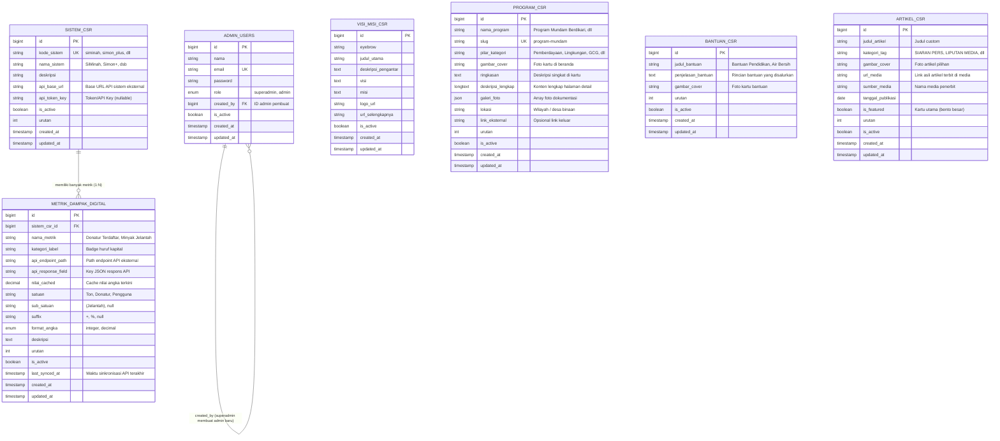

# SKEMA DAN RANCANGAN DATABASE (DATABASE.MD)
## Web Pemetaan 360 & Portal Keberlanjutan CSR

Dokumen ini mendefinisikan arsitektur basis data relasional (MySQL) untuk platform CSR, disusun berdasarkan kebutuhan tiap section pada halaman beranda serta dashboard admin CMS.

---

## 1. Diagram Relasi Entitas (ERD)

---

## 2. Rincian Spesifikasi Tabel

### 2.1. Tabel `admin_users`
Menyimpan kredensial akun pengelola web. Akun awal dibuat langsung di database (seed), dan penambahan akun admin berikutnya dapat dilakukan oleh admin awal.

| Kolom | Tipe Data | Atribut | Keterangan |
|---|---|---|---|
| `id` | BIGINT | PK, Auto Increment | Identitas unik akun |
| `nama` | VARCHAR(150) | Not Null | Nama lengkap admin |
| `email` | VARCHAR(150) | Not Null, Unique | Email login |
| `password` | VARCHAR(255) | Not Null | Hash password (bcrypt) |
| `role` | ENUM | `'superadmin'`, `'admin'` | Hak akses (superadmin = admin awal) |
| `created_by` | BIGINT | Nullable, FK -> `admin_users.id` | Menandai admin yang membuat akun ini |
| `is_active` | BOOLEAN | Default true | Status akun aktif/nonaktif |
| `created_at` | TIMESTAMP | Nullable | Waktu registrasi |
| `updated_at` | TIMESTAMP | Nullable | Waktu perubahan |

---

### 2.2. Tabel `visi_misi_csr`
Menyimpan teks dan identitas visual pada section Visi & Misi CSR.

| Kolom | Tipe Data | Atribut | Keterangan |
|---|---|---|---|
| `id` | BIGINT | PK, Auto Increment | Identitas baris |
| `eyebrow` | VARCHAR(100) | Default `'VISI & MISI CSR'` | Label kecil di atas judul |
| `judul_utama` | VARCHAR(255) | Not Null | Judul utama seksi visi misi |
| `deskripsi_pengantar`| TEXT | Nullable | Paragraf pengantar komitmen CSR |
| `visi` | TEXT | Not Null | Paragraf visi CSR |
| `misi` | TEXT | Not Null | Poin-poin misi CSR |
| `logo_url` | VARCHAR(255) | Nullable | URL gambar/logo CSR |
| `url_selengkapnya` | VARCHAR(255) | Nullable | Link tujuan tombol "Selengkapnya" |
| `is_active` | BOOLEAN | Default true | Status aktif untuk ditampilkan |
| `created_at` | TIMESTAMP | Nullable | Waktu dibuat |
| `updated_at` | TIMESTAMP | Nullable | Waktu diperbarui |

---

### 2.3. Tabel `sistem_csr` (Master Sistem CSR)
Menyimpan daftar sistem aplikasi CSR yang terintegrasi (seperti SiMinah, Simon+, dan sistem-sistem baru yang akan dibuat CSR di masa mendatang).

| Kolom | Tipe Data | Atribut | Keterangan |
|---|---|---|---|
| `id` | BIGINT | PK, Auto Increment | Identitas sistem |
| `kode_sistem` | VARCHAR(50) | Not Null, Unique | Identifier unik (contoh: `siminah`, `simon_plus`) |
| `nama_sistem` | VARCHAR(100) | Not Null | Nama resmi (contoh: `SiMinah`, `Simon+`) |
| `deskripsi` | TEXT | Nullable | Keterangan fungsi sistem |
| `api_base_url` | VARCHAR(255) | Nullable | URL endpoint dasar API sistem database eksternal |
| `api_token_key` | VARCHAR(255) | Nullable | API Key / Bearer Token jika API private |
| `urutan` | INT | Default 0 | Urutan penyebutan di web |
| `is_active` | BOOLEAN | Default true | Status tampil di web publik |
| `created_at` | TIMESTAMP | Nullable | Waktu dibuat |
| `updated_at` | TIMESTAMP | Nullable | Waktu diperbarui |

---

### 2.4. Tabel `metrik_dampak_digital` (Data Metrik & Angka Sistem)
Menyimpan metrik dampak terukur. Angka tidak diinput manual, melainkan diambil dari API database sistem terkait dan di-cache secara berkala.

| Kolom | Tipe Data | Atribut | Keterangan |
|---|---|---|---|
| `id` | BIGINT | PK, Auto Increment | Identitas metrik |
| `sistem_csr_id` | BIGINT | FK -> `sistem_csr.id` | Sistem pemilik metrik |
| `nama_metrik` | VARCHAR(150) | Not Null | Nama metrik (contoh: *Donatur Terdaftar*) |
| `kategori_label`| VARCHAR(100) | Not Null | Badge teks kapital (contoh: `DONATUR TERDAFTAR (SIMINAH)`) |
| `api_endpoint_path` | VARCHAR(255) | Nullable | Path API spesifik (misal: `/api/v1/donatur/count`) |
| `api_response_field` | VARCHAR(100) | Nullable | Nama field dalam JSON respon (misal: `data.total`) |
| `nilai_cached` | DECIMAL(12,2) | Default 0 | Nilai angka terakhir yang berhasil ditarik dari API |
| `satuan` | VARCHAR(50) | Not Null | Satuan (contoh: `Donatur`, `Ton`, `Pengguna Aktif`) |
| `sub_satuan` | VARCHAR(50) | Nullable | Keterangan sub-satuan (contoh: `(Jelantah)`) |
| `suffix` | VARCHAR(10) | Nullable | Simbol akhiran (contoh: `+`, `%`) |
| `format_angka` | ENUM | `'integer'`, `'decimal'` | Format tampilan angka counter di frontend |
| `deskripsi` | TEXT | Nullable | Penjelasan capaian dampak |
| `urutan` | INT | Default 0 | Urutan letak kolom metrik di beranda |
| `is_active` | BOOLEAN | Default true | Status tampil di web |
| `last_synced_at`| TIMESTAMP | Nullable | Timestamp penarikan data API terakhir |
| `created_at` | TIMESTAMP | Nullable | Waktu dibuat |
| `updated_at` | TIMESTAMP | Nullable | Waktu diperbarui |

---

### 2.5. Tabel `program_csr` (Program CSR & Halaman Detail)
Menyimpan kartu program CSR di halaman utama yang dapat diklik untuk membuka halaman detail program.

| Kolom | Tipe Data | Atribut | Keterangan |
|---|---|---|---|
| `id` | BIGINT | PK, Auto Increment | Identitas program |
| `nama_program` | VARCHAR(255) | Not Null | Nama program (contoh: *Program Kampung Mundam Berdikari*) |
| `slug` | VARCHAR(255) | Not Null, Unique | URL slug ramah SEO (`/program/program-mundam`) |
| `pilar_kategori`| VARCHAR(100) | Not Null | Kategori pilar (contoh: *Pertamina Berdikari*, *Hijau*) |
| `gambar_cover` | VARCHAR(255) | Not Null | Foto utama pada kartu showcase di beranda |
| `ringkasan` | TEXT | Not Null | Penjelasan singkat yang muncul di kartu beranda |
| `deskripsi_lengkap` | LONGTEXT | Not Null | Konten lengkap untuk halaman detail (format HTML/RichText) |
| `galeri_foto` | JSON | Nullable | Array daftar URL foto dokumentasi kegiatan |
| `lokasi` | VARCHAR(150) | Nullable | Nama lokasi/desa binaan program |
| `link_eksternal`| VARCHAR(255) | Nullable | Tautan khusus jika mengarah ke situs eksternal |
| `urutan` | INT | Default 0 | Urutan urutan tampil kartu |
| `is_active` | BOOLEAN | Default true | Status publikasi |
| `created_at` | TIMESTAMP | Nullable | Waktu dibuat |
| `updated_at` | TIMESTAMP | Nullable | Waktu diperbarui |

---

### 2.6. Tabel `bantuan_csr` (Penyaluran Bantuan CSR)
Menyimpan data kartu penyaluran bantuan yang sifatnya informatif di tempat (tidak memiliki halaman detail / tidak bisa diklik).

| Kolom | Tipe Data | Atribut | Keterangan |
|---|---|---|---|
| `id` | BIGINT | PK, Auto Increment | Identitas bantuan |
| `judul_bantuan` | VARCHAR(200) | Not Null | Judul (contoh: *Bantuan Pendidikan*, *Sarana Air Bersih APO*) |
| `penjelasan_bantuan`| TEXT | Not Null | Isi teks rincian bantuan yang disalurkan |
| `gambar_cover` | VARCHAR(255) | Nullable | Gambar latar atau ilustrasi kartu |
| `urutan` | INT | Default 0 | Urutan kartu di seksi penyaluran bantuan |
| `is_active` | BOOLEAN | Default true | Status tampil di beranda |
| `created_at` | TIMESTAMP | Nullable | Waktu dibuat |
| `updated_at` | TIMESTAMP | Nullable | Waktu diperbarui |

---

### 2.7. Tabel `artikel_csr` (Publikasi Media & Berita)
Menyimpan tautan artikel CSR yang telah dipublikasikan di media eksternal, dengan judul dan gambar yang dapat dikustomisasi sendiri oleh admin.

| Kolom | Tipe Data | Atribut | Keterangan |
|---|---|---|---|
| `id` | BIGINT | PK, Auto Increment | Identitas artikel |
| `judul_artikel` | VARCHAR(255) | Not Null | Judul kustom yang ditentukan admin |
| `kategori_tag` | VARCHAR(100) | Default `'SIARAN PERS'` | Label tag (contoh: `SIARAN PERS`, `LIPUTAN MEDIA`) |
| `gambar_cover` | VARCHAR(255) | Not Null | URL foto yang diunggah/dipilih sendiri |
| `url_media` | VARCHAR(500) | Not Null | Tautan asli ke artikel yang sudah tayang di media luar |
| `sumber_media` | VARCHAR(100) | Nullable | Nama media luar (contoh: *Detik.com*, *Kompas*, *Pertamina.com*) |
| `tanggal_publikasi` | DATE | Not Null | Tanggal artikel tayang |
| `is_featured` | BOOLEAN | Default false | `true` jika menjadi sorotan utama (kartu besar di bento grid) |
| `urutan` | INT | Default 0 | Urutan tampilan kartu |
| `is_active` | BOOLEAN | Default true | Status tampil |
| `created_at` | TIMESTAMP | Nullable | Waktu dibuat |
| `updated_at` | TIMESTAMP | Nullable | Waktu diperbarui |

---

## 3. Catatan Pengembangan Khusus

1. **Section Tentang Kami:**
   * Dikecualikan sementara dari tabel database sesuai instruksi, konten tetap bersumber dari komponen statis beranda sampai siap didiskusikan lebih lanjut.

2. **Section Hero (Peta Sebaran & Virtual Tour 360):**
   * Disimpan untuk pembahasan struktur terpisah selanjutnya. Akan dirancang mencakup data titik koordinat wilayah, scene foto panorama 360 equirectangular, dan interaktivitas hotspot.

3. **Mekanisme Penarikan API SiMinah, Simon+, & Sistem Lain:**
   * Frontend tidak langsung menembak API pihak ketiga untuk menghindari masalah CORS dan beban request berlebih.
   * Backend (Laravel/Node) menjalankan *scheduled worker / cron* (misalnya tiap 15 menit atau 1 jam sekali) untuk membaca `api_base_url` + `api_endpoint_path`, kemudian memperbarui kolom `nilai_cached` dan `last_synced_at` pada tabel `metrik_dampak_digital`.
   * Frontend selalu membaca nilai dari `nilai_cached`, menjamin loading beranda sangat cepat dan tahan gangguan jika API eksternal sedang *down*.
